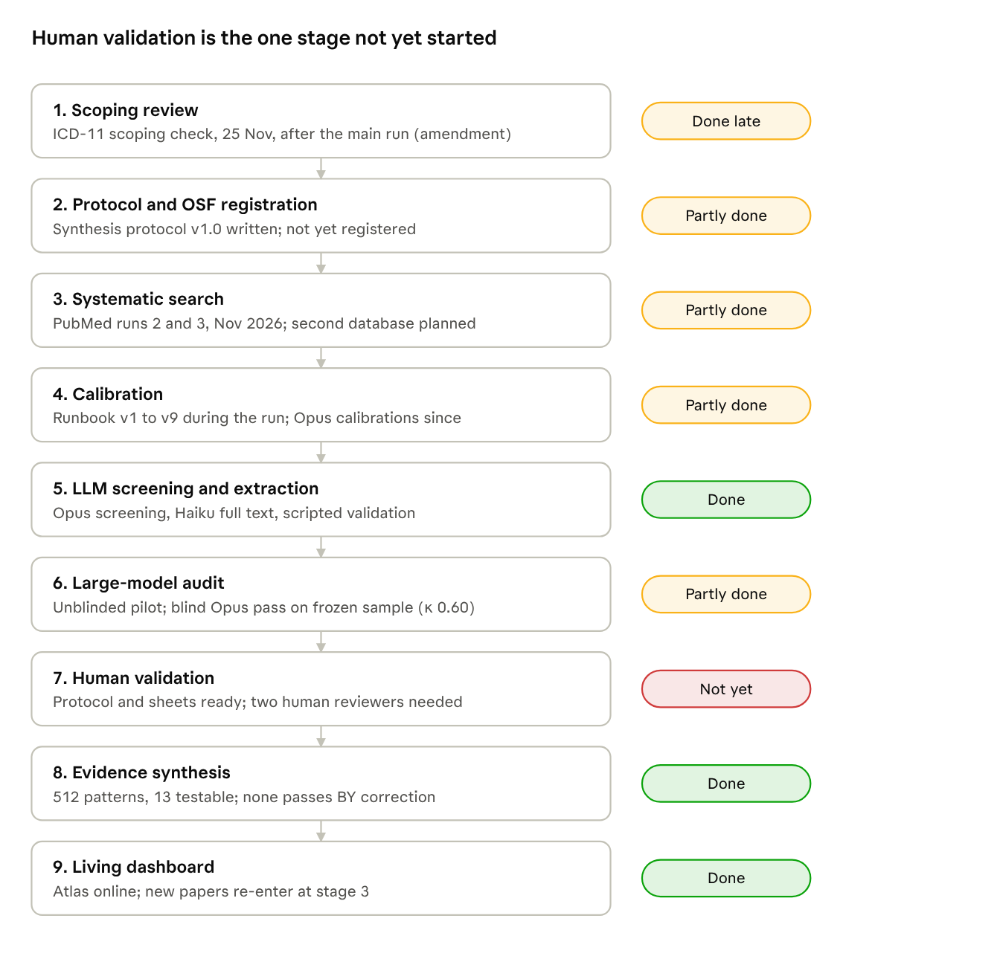
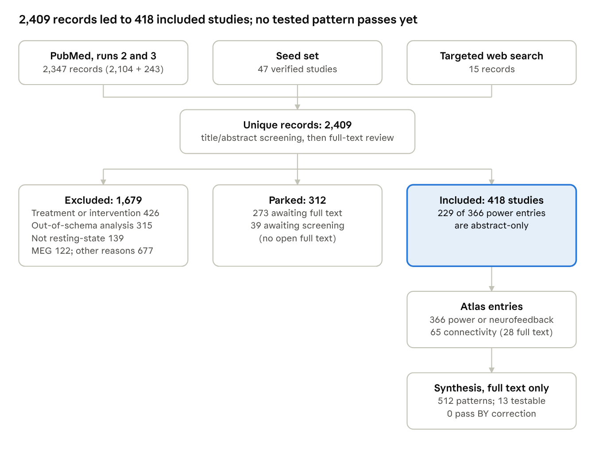

# Neurofeedback Atlas: an AI-assisted living evidence map of resting-state EEG differences across 20 disorders — methods and resource

Working draft, 26 November 2026

## Title page

**Article type:** Methods and resource article (living evidence map with a pre-specified synthesis protocol).

**Short title:** Neurofeedback Atlas: a living map of resting-state EEG findings

**Authors:** \[Full name\]¹ — add co-authors, including the human second reviewer(s) and the statistician once involved.

¹ \[Affiliation, city, country\]

**Corresponding author:** \[Name, email, ORCID\]

**Keywords:** resting-state EEG; quantitative EEG; spectral power; functional connectivity; evidence map; living systematic review; vote counting; GRADE; large language models; neurofeedback

**Word count (main text):** \[fill in at submission\] · **Tables:** 5 · **Figures:** 2 (workflow; study flow); add a screenshot of the atlas as Figure 3

**Data and code:** https://github.com/farrokh143/eeg-disorder-atlas · **Live atlas:** https://farrokh143.github.io/eeg-disorder-atlas/

## Abstract

**Background.** Resting-state EEG differences have been reported for most psychiatric and neurological disorders, but findings are spread across thousands of papers that use different bands, sites and measures. Clinicians, researchers and neurofeedback practitioners lack one place that shows, per scalp region and band, how consistent a reported difference is.

**Methods.** We built the Neurofeedback Atlas, an open, living evidence map of resting-state EEG band power and undirected functional connectivity across 20 disorder groups (13 chosen at the start and 7 added after an ICD-11 scoping check). PubMed was searched with a pre-specified query per disorder (November 2026). A large language model (LLM; Claude Opus) screened titles and abstracts, and a small LLM (Claude Haiku) extracted data from full texts following a written runbook. Every entry passed scripted validation and is logged in a version-controlled database; an earlier unblinded audit and a blind comparison with the large model on a frozen validation sample checked the small model's entries. Each study contributes one direction-of-effect vote per pattern (condition × band × scalp region or region pair). Patterns are synthesised with an exact sign test, a √n-weighted sign-flip test and Benjamini–Yekutieli false-discovery control, and certainty is rated with GRADE. Only results verified in full text enter pooled analyses. The ICD-11-based disorder scope was applied as a dated amendment; human validation of the LLM decisions is the main pending step.

**Results.** Of 2,409 records, 418 were included, 273 await full text, 39 await screening and 1,679 were excluded with a logged reason. The atlas holds 366 band-power or neurofeedback entries and 65 connectivity entries; 229 of the 366 band-power or neurofeedback entries (63%) rest on the abstract alone. Of 512 patterns, 13 had enough full-text studies to test, and none passed correction. Connectivity was too sparse to test (at most 3 independent full-text studies per region pair). Adding abstract-only evidence in a sensitivity analysis, 21 power patterns were consistent, including EEG slowing in Alzheimer's disease, frontal theta in ADHD and frontal theta in schizophrenia. In a blind comparison with Claude Opus on a frozen sample, the pipeline agreed on 80% of screening decisions (κ 0.60); extraction agreement was 98% for condition and 72% for bands and directions. Human validation is pending.

**Conclusions.** A transparent, reproducible pipeline can map a large, heterogeneous EEG literature and state how strong each link is. Its current bottleneck is full-text access, not search or synthesis. The atlas is a research reference; group-level differences are not diagnostic tests for individuals.

*\[Before submission: add the human–LLM agreement figure and the protocol registration ID here.\]*

## 1. Introduction

Resting-state EEG is cheap, non-invasive and widely recorded, and group differences in spectral power have been reported for most major disorders (Newson & Thiagarajan, 2019). Some findings are well known, such as EEG slowing in Alzheimer's disease or an elevated theta/beta ratio in ADHD. Others have not held up: the theta/beta ratio, once proposed as a diagnostic aid, showed declining effect sizes in later samples (Arns et al., 2013).

Three features of this literature make it hard to use. First, results are reported at different levels: single electrodes, regions, whole-head averages or source estimates. Second, studies differ in bands, eyes condition, reference and measure, so effect sizes are rarely poolable across them. Third, reviews are usually written for one disorder at a time and become outdated quickly, so the same EEG pattern is seldom compared across disorders.

A living evidence map addresses these problems by keeping one consistent record of every study, updating it as new papers appear, and stating per pattern how consistent the evidence is (Elliott et al., 2017). Such maps are labour-intensive to maintain. LLMs can now screen and extract at scale, but their use in evidence synthesis needs transparent rules, automated checks and a full audit trail.

This paper describes the Neurofeedback Atlas, a public atlas that links resting-state EEG patterns (band, direction, scalp region and region pair) to 20 disorder groups and their core symptoms. We report (1) the pipeline, in which LLM reviewers follow a written runbook and every decision is validated and version-controlled; (2) a pre-specified direction-of-effect synthesis with false-discovery control and GRADE certainty; and (3) the current state of the evidence, presented as preliminary because most entries are not yet verified in full text.

## 2. Methods

Reporting follows PRISMA 2020 (Page et al., 2021) for the search and selection, and SWiM (Campbell et al., 2020) for the synthesis. The synthesis protocol (v1.0, 22 November 2026) was written before it was first run on connectivity data. *\[It was not registered in advance; state this, and give the registration ID of the version registered before submission.\]*

### Workflow overview

The review runs in nine stages (Figure 1). Stages 5, 8 and 9 are complete. Stages 1, 4 and 6 were done after the main run, as dated amendments or on parts of the data (below). Stages 2 and 3 are partly complete (no registration yet; PubMed only). Human validation (stage 7) has not been done. Each stage is described below as it was actually carried out, with planned changes marked as such.



*Figure 1. Workflow from scoping to living dashboard, with the status of each stage on 25 November 2026. New papers re-enter at stage 3 and pass stages 3–7 before they appear in the atlas.*

### 2.1 Eligibility

- **Participants:** humans with one of 20 disorder groups (ADHD; Alzheimer's disease and mild cognitive impairment; schizophrenia; depression; anxiety; PTSD; autism; epilepsy; Parkinson's disease; alcohol and substance use; traumatic brain injury; insomnia; migraine) or one of seven groups added after the scoping check (stroke; bipolar disorder; obsessive–compulsive disorder; Lewy body dementia; frontotemporal dementia; multiple sclerosis; learning disorders), compared with controls or related to symptom severity.
- **Recording:** awake resting scalp EEG, eyes open or closed. Task, evoked (e.g. ERP, ASSR), sleep, MEG, intracranial and imaging studies were excluded.
- **Measures:** band power with a direction and scalp site (or a stated whole-head result); undirected connectivity (coherence, PLI/wPLI/PLV, amplitude-envelope correlation) between named sites or regions. Graph metrics, microstates, directed measures, classifier outputs, aperiodic exponent, burst statistics, peak alpha frequency and alpha reactivity were excluded.
- **Other exclusions:** drug, stimulation, surgery or psychotherapy effects and treatment-response prediction; case reports; animal and modelling studies; source-space-only results without a scalp-level mapping.
- **Secondary layer:** neurofeedback studies with a stated protocol (band, direction, sites), any design. These are shown in the atlas but are not part of the synthesis.

**Diagnostic classification (amendment of 25 November 2026).** The 13 conditions were chosen by the author before searching, not derived from a scoping review. To make the scope reproducible, a dated protocol amendment bases it on ICD-11, the WHO standard in effect since January 2022. Scope is set by chapter: 6 (mental, behavioural or neurodevelopmental disorders), 7 (sleep–wake disorders) and 8 (diseases of the nervous system), plus traumatic brain injury and concussion.

Each study's own diagnostic system (DSM-IV, DSM-5, ICD-10) is recorded for every entry and each entry carries an ICD-11 group (fields dx and icd11; mapping with the WHO tables). Of 103 disorders rated in both ICD-11 and DSM-5, 73 (71%) were essentially identical or differed only in minor definitional ways (First et al., 2021). Still to do: current groups are to be split where ICD-11 separates them: mild neurocognitive disorder (6D71) from dementia due to Alzheimer disease (6D80); generalised anxiety, panic and social anxiety disorders; and substance use disorders by substance.

Epilepsy is flagged because EEG is part of its diagnosis. Coma, disorders of consciousness and anaesthesia are excluded, because they are not awake resting recordings. Synthesis will be at the ICD-11 category level, with finer codes and the original 13 conditions as sensitivity analyses. The amendment will also set rules for comorbid, mixed-diagnosis and non-clinical high-trait samples; RDoC or HiTOP dimensions may be used as a secondary symptom layer.

**Scoping check (25 November 2026).** After the main search, one resting-EEG PubMed query was run for each candidate disorder in ICD-11 chapters 6–8 and NA07, with thresholds fixed beforehand: 20 hits to be a candidate, 3 studies to enter the atlas and 6 to test a pattern. Eight disorders passed: stroke (143 hits), bipolar disorder (62), intellectual disability (53), dementia with Lewy bodies (40), learning disorders (37), obsessive–compulsive disorder (33), multiple sclerosis (23) and frontotemporal dementia (22). They were searched and screened as a third run (244 records); seven now have atlas entries and intellectual disability has none. Disorders of consciousness (91 hits), tinnitus (68) and chronic pain (48) have literature but are out of scope. Only five ICD-11 codes (6D71, 6D80, 6D82, 8B60.0, NA07) have been checked against the WHO listings; the others are provisional. The counts are in data/scoping-2026-11-25.tsv.

### 2.2 Information sources and search

PubMed was searched on 21 November 2026 through the PubMed API connector. The core query combined EEG terms, resting-state terms and spectral terms with each disorder's MeSH heading and humans\[mh\]:

```
(electroencephalography[mh] OR EEG[tiab] OR qEEG[tiab] OR electroencephalogram[tiab])
AND (resting[tiab] OR "eyes closed"[tiab] OR "eyes open"[tiab])
AND (power[tiab] OR spectral[tiab] OR spectrum[tiab] OR asymmetry[tiab] OR theta[tiab]
     OR alpha[tiab] OR delta[tiab] OR beta[tiab] OR gamma[tiab] OR oscillations[tiab])
AND humans[mh] AND [DISORDER MeSH]
```

An earlier version (v1) missed 2 of 6 benchmark papers because their abstracts said "theta activity" rather than "power"; the final query (v2) found all 6. A seed set of 47 hand-picked studies with verified citations and a targeted web search for under-covered disorders (15 records) were added. All per-disorder search strings are in Supplementary File S1.

A third run (query v3, 25 November 2026) searched the eight disorders added by the scoping check (§2.1) with the same core query and added 243 new records to the log.

**Planned disorder-neutral search.** For the ICD-11 amendment, one resting-EEG search without a disorder filter will be run (about 2,700 PubMed records, many already in the log), and every hit will be classified to ICD-11. At least one more database (Embase or PsycINFO) will be added. A disorder will be shown in the atlas at 3 or more independent studies and tested at 6 or more (§2.6). The amendment will be registered on OSF before this search is run.

### 2.3 Selection and data extraction

Selection and extraction followed stages 4–7 of the workflow. Every decision was written to a version-controlled log (`research-log.csv`, one row per record, with status and reason). Model names, versions, prompts (the runbook) and run dates are reported in line with the RAISE recommendations (Thomas et al., 2025), which the joint Cochrane, Campbell, JBI and CEE position statement supports; that statement asks for human oversight and full reporting of any AI use that makes or suggests judgements (Flemyng et al., 2025).

1. **Title/abstract screening (stage 5).** Four rounds grouped by disorder, by a single large LLM reviewer (Claude Opus).
2. **Runbook development (stage 4).** The full-text instructions (`RUNBOOK.md`) were refined during the run, from version 1 to version 9, as edge cases arose. This was iterative development, not a calibration fixed in advance. For all new searches, a formal calibration will come first: humans and Claude Opus screen and extract a random pilot set of 50–100 records; the runbook is revised until Claude Haiku agrees with that reference to a pre-set threshold; then the runbook version is frozen. This has been done twice so far, with Opus alone as the reference (humans have not yet taken part) and a 20-record set each time: for the enrichment pass (eye state, power type, ICD-11 group, diagnostic system), where the first calibration reached 80% against an 85% gate, the rules were revised and the second passed; and for screening of the seven added disorders, where agreement on the include decision was 90%.
3. **Full-text review and extraction (stage 5).** A small LLM (Claude Haiku) reviewed papers in batches of 10, each merged as its own pull request, using open full text from PubMed Central. Where no full text was available but the abstract reported band, direction and sites, the entry was added and labelled *abstract-only*; papers with neither were *parked*. Fields: condition, sites (10–20 system, old T3–T6 naming; Jasper, 1958), per-band direction, connectivity pairs, symptoms, design level (1–5), control type, blinding and sample size. Numbers not verified in the text were left blank.
4. **Scripted validation (stage 5).** Entries could only be written through `apply-review.js`, which rejects unknown identifiers, missing directions, global connectivity (10 or more pairs) and other rule breaks.
5. **Large-model audit (stage 6).** Claude Opus re-checked all 264 entries added by Haiku and found no substantive errors. This audit was neither blinded nor pre-specified, so it is reported as a pilot. A second, blind pass compared the pipeline with Opus on the frozen validation sample (150 screening and 60 extraction items, stratified, drawn on 25 November 2026 with seed 20261125; pipeline answers were frozen first). Screening agreement was 80% (κ 0.60). Extraction agreement was 98% for condition, 93% for design, 80% for sample size and 72% for bands and directions. An Opus clean-up of 20 flagged entries corrected sites, sample sizes and details and removed one duplicate. Disagreements on the validation sample go to the human reviewers.
6. **Human validation (stage 7, pending).** Two independent human reviewers will check a stratified random sample across both models' outputs. For screening we will report sensitivity and specificity; for extraction, per-field agreement (κ or percentage agreement). Humans are the reference standard: agreement between two models is not treated as validation. Thresholds are fixed in advance (validation protocol v1.0): screening sensitivity of at least 90% with a lower 95% confidence bound of at least 80%, and extraction agreement of at least 85%. The sheets are prepared and blank. If accuracy falls below a threshold, the stage is corrected and re-run.

*\[Report stage 7 results here: sample size and sampling frame, sensitivity and specificity for screening, per-field κ for extraction, and any stage that was re-run.\]*

### 2.4 Unit of synthesis

A **pattern** is one condition × feature (power or connectivity) × band × location. Locations are five scalp regions (Table 1) for power and 15 unordered region pairs for connectivity. Connectivity measure families (coherence; phase synchrony; amplitude-envelope correlation; other undirected) are synthesised separately, because coherence is inflated by volume conduction and phase-lag measures are not (Nunez et al., 1997; Stam et al., 2007).

**Table 1. Scalp regions**

| Region | 10–20 electrodes |
| --- | --- |
| Frontal | Fp1, Fp2, F7, F3, Fz, F4, F8 |
| Central | C3, Cz, C4 |
| Temporal | T3, T4, T5, T6 |
| Parietal | P3, Pz, P4 |
| Occipital | O1, O2 |

Whole-head results count towards every region and are flagged.

### 2.5 Independence of votes

Each independent sample casts one vote per pattern: *higher*, *lower* or *unclear* (no difference, or mixed directions within the pattern). Reports with the same first author, condition and total n were treated as one sample unless the full text showed otherwise. Within a study, eyes-closed results took priority over eyes-open when they disagreed. Meta-analyses were not pooled with primary studies, to avoid counting participants twice; they were used as external corroboration and in the inconsistency judgement.

### 2.6 Statistical synthesis

Following Cochrane Handbook chapter 12 (McKenzie & Brennan, 2024), we used vote counting by direction of effect, not by statistical significance. For a pattern with h higher, l lower and u unclear votes:

- **Consistency:** p̂ = max(h, l) / (h + l), with a Wilson 95% confidence interval (Wilson, 1927).
- **Primary test:** exact two-sided sign test of H₀: π = 0.5 on h and l. Unclear votes are excluded from the test but reported.
- **Weighted test:** S = Σ wᵢsᵢ with sᵢ = ±1 and wᵢ = √nᵢ; the exact null distribution comes from enumerating all sign flips (k ≤ 20) or 100,000 Monte Carlo flips with a fixed seed.
- **Minimum evidence:** patterns with fewer than 6 clear-direction studies cannot reach p < 0.05 (5 of 5 gives p = 0.0625); they are reported descriptively and not tested. The sign test is used only to test whether directions are balanced, not to estimate effects, because it is unsuitable for estimation (Nikolakopoulos, 2021).
- **Multiplicity:** Benjamini–Yekutieli q-values over all testable patterns in a run, valid under any dependence (Benjamini & Yekutieli, 2001). A *consistent difference* is q\_BY < 0.05.

Only entries verified in full text (and 46 hand-curated entries with verified citations) enter pooled analyses.

### 2.7 Certainty of evidence

Certainty was rated with GRADE for evidence without a single pooled estimate (Murad et al., 2017), starting at High for observational evidence about group factors (Foroutan et al., 2020). Rules are applied by code so every rating is reproducible (Table 2).

**Table 2. GRADE downgrading rules**

| Domain | Down one level when | Down two levels when |
| --- | --- | --- |
| Risk of bias | >50% of √n weight from design level ≤ 2 | >50% of weight from design level 1 |
| Inconsistency | p̂ < 0.75, or u ≥ k/3, or a meta-analysis points the other way | p̂ < 0.6 |
| Imprecision | total n < 400 or < 6 clear-direction studies | both |
| Indirectness | symptom link inferred through diagnosis, or >50% of votes from whole-head results | — |
| Publication bias | all studies n < 50 and all one way, or far fewer unclear votes in abstracts than full texts | — |

A pattern can be rated up one level when q\_BY < 0.001, p̂ ≥ 0.9 and k ≥ 10.

### 2.8 Sensitivity analyses

S1 adds abstract-only entries; S2 removes design level 1; S3 leaves one study out at a time; S4 removes whole-head results; S5 pools connectivity measure families; S6 uses Benjamini–Hochberg (Benjamini & Hochberg, 1995); S7 keeps one vote per first author per condition. A result is *robust* when it holds in S2, S3, S4 and S7.

### 2.9 Software and availability

The atlas is a single static web page (vanilla JavaScript) reading `data/research.js`. All statistics are computed by `tools/synthesize.js`, which is deterministic and tested against known binomial and Wilson values (`tools/test-synthesize.js`). The repository's commit history is the audit trail for every search, decision and rule change.

## 3. Results

### 3.1 Study selection

The first two searches produced 2,166 unique records: 2,104 new PubMed records, 47 seed studies and 15 from the targeted web search. The ICD-11 scoping check added a third run, bringing the log to 2,409 records. After screening and full-text review, 418 were included, 273 were parked awaiting full text, 39 were parked awaiting screening, and 1,679 were excluded with a logged reason (Figure 2).



*Figure 2. Study flow. Counts are from the research log on 26 November 2026; reformat to the PRISMA 2020 template for submission.*

The most common exclusion reasons were treatment, drug, stimulation or other non-marker studies (426), connectivity, network, microstate or classifier analyses outside the original schema (315; mostly screened before connectivity entered scope), non-resting EEG (139), MEG (122), off-topic papers (89), non-band-power measures (79) and intracranial recordings (71). The full list of reasons is in Supplementary File S2.

### 3.2 Corpus

The atlas holds 366 band-power or neurofeedback entries (330 resting-EEG markers and 36 neurofeedback studies; 92 verified in full text, 45 hand-curated with verified citations, 229 abstract-only) and 65 connectivity entries (28 verified in full text, 37 abstract-only), across 20 disorder groups plus healthy cognition. Most entries added by the LLM review were taken from the abstract alone because PubMed Central had no open full text. Every entry now records eye state, absolute or relative power, ICD-11 group and diagnostic system; eye state is still unclear for 236 of 431 entries and power type for 176 of 330 markers. Table 3 shows coverage by disorder.

**Table 3. Records by disorder and status**

| Disorder (first-listed) | Included | Awaiting full text or screening | Excluded |
| --- | --- | --- | --- |
| Alzheimer's | 67 | 111 | 289 |
| Depression | 66 | 22 | 247 |
| ADHD | 59 | 47 | 141 |
| Schizophrenia | 53 | 26 | 182 |
| Alcohol & substance use | 27 | 12 | 88 |
| Autism | 24 | 11 | 115 |
| Stroke | 23 | 10 | 98 |
| Epilepsy | 17 | 14 | 186 |
| Parkinson's | 17 | 9 | 111 |
| Anxiety (incl. OCD) | 16 | 11 | 58 |
| Migraine | 11 | 2 | 15 |
| PTSD | 9 | 1 | 27 |
| Brain injury (TBI) | 8 | 2 | 27 |
| Learning disorders | 7 | 3 | 21 |
| Healthy cognition | 5 | 0 | 0 |
| Insomnia | 3 | 4 | 23 |
| Multiple sclerosis | 3 | 3 | 14 |
| Bipolar disorder | 2 | 3 | 13 |
| Lewy body dementia | 1 | 2 | 3 |
| Intellectual disability | 0 | 18 | 18 |
| Frontotemporal dementia | 0 | 0 | 1 |
| Unassigned (catch-up search) | 0 | 1 | 2 |
| **Total** | **418** | **312** | **1,679** |

*Each record is counted once, under the first disorder listed for it in the research log, so the columns add up to the totals (418 / 273 + 39 / 1,679). Records that concern several disorders (for example Alzheimer's with Lewy body dementia) are therefore counted under one only.*

### 3.3 Synthesis

The synthesis defined 512 patterns. On full-text evidence, 13 band-power patterns had at least 6 clear-direction studies and could be tested: nine for Alzheimer's disease, two for ADHD (frontal and central theta), and one each for schizophrenia (frontal theta) and stroke (frontal delta). None reached q\_BY < 0.05; the smallest q\_BY was 0.081, for raised theta in Alzheimer's disease at occipital and frontal sites (9 of 10 studies higher, 1 unclear; Table 4). Under Benjamini–Hochberg instead (sensitivity analysis S6), 11 of the 13 would pass: nine Alzheimer's patterns, frontal theta in schizophrenia and frontal delta after stroke. Benjamini–Yekutieli is the pre-specified primary procedure, so these are reported as sensitivity results only. No pattern was robust across S2, S3, S4 and S7.

Connectivity could not be tested. No region pair had more than 3 independent full-text studies. Even with abstract-only entries added and all measure families pooled (S1 + S5), the largest pattern was ADHD frontal–frontal theta connectivity: 6 of 7 studies higher, not significant after correction.

When abstract-only entries were added (S1), 21 power patterns (14 for Alzheimer's disease, 4 for ADHD, 3 for schizophrenia) met the consistency criterion. These included EEG slowing in Alzheimer's disease, raised frontal theta in ADHD and raised theta in schizophrenia. These results agree with earlier reviews but should be read as hypotheses until the underlying full texts are checked.

**Table 4. Testable patterns (full-text evidence only)**

| Condition | Band | Region | k | Higher / lower / unclear | Share (95% CI) | q\_BY | Certainty | With abstracts (S1) |
| --- | --- | --- | --- | --- | --- | --- | --- | --- |
| Alzheimer's | theta | occipital | 10 | 9 / 0 / 1 | 100% (70–100) | 0.081 | Moderate | consistently higher |
| Alzheimer's | theta | frontal | 10 | 9 / 0 / 1 | 100% (70–100) | 0.081 | Moderate | consistently higher |
| Alzheimer's | theta | parietal | 9 | 8 / 0 / 1 | 100% (68–100) | 0.081 | Low | consistently higher |
| Alzheimer's | theta | temporal | 9 | 8 / 0 / 1 | 100% (68–100) | 0.081 | Low | consistently higher |
| Alzheimer's | alpha | occipital | 9 | 0 / 7 / 2 | 100% (65–100) | 0.117 | Low | consistently lower |
| Alzheimer's | alpha | frontal | 9 | 0 / 6 / 3 | 100% (61–100) | 0.117 | Very low | no consistent difference |
| Alzheimer's | alpha | parietal | 8 | 0 / 6 / 2 | 100% (61–100) | 0.117 | Low | consistently lower |
| Alzheimer's | alpha | temporal | 8 | 0 / 6 / 2 | 100% (61–100) | 0.117 | Low | consistently lower |
| Alzheimer's | beta | occipital | 7 | 0 / 6 / 1 | 100% (61–100) | 0.117 | Moderate | consistently lower |
| Schizophrenia | theta | frontal | 7 | 6 / 0 / 1 | 100% (61–100) | 0.117 | Low | consistently higher |
| Stroke | delta | frontal | 6 | 6 / 0 / 0 | 100% (61–100) | 0.117 | Very low | no consistent difference |
| ADHD | theta | frontal | 7 | 5 / 1 / 1 | 83% (44–97) | 0.696 | Moderate | consistently higher |
| ADHD | theta | central | 7 | 5 / 1 / 1 | 83% (44–97) | 0.696 | Moderate | consistently higher |

*k = independent studies. Share = studies in the majority direction among those with a clear direction, with Wilson 95% CI. All 13 are power patterns; none is robust. Source: `methods/synthesis-results.md`, generated 25 November 2026; the full list of 512 patterns is in Supplementary File S3.*

### 3.4 Validation and calibration so far

On the frozen validation sample, Claude Opus, working blind, agreed with the pipeline on 80% of 150 screening decisions (κ 0.60). Extraction agreement on 60 entries is shown in Table 5. It was high for condition and design but low for sites (50%) and for bands and directions (72%). These are the fields that decide which pattern a study votes in, so the human check matters most for them. The calibrations in §2.3 reached 80% and then, after rule changes, 85–100% for the enrichment fields, and 90% on the include decision for run 3 screening; in that set, band directions matched in only 1 of the 3 papers both models included, and an alpha-reactivity rule was added.

**Table 5. Extraction agreement, pipeline vs Claude Opus (blind), frozen sample**

| Field | Agreement | Items compared |
| --- | --- | --- |
| Condition | 98.3% | 60 |
| Study design | 93.3% | 60 |
| ICD-11 group | 81.4% | 59 |
| Sample size (n) | 79.6% | 54 |
| Power type | 74.6% | 59 |
| Eye state | 72.9% | 59 |
| Bands and directions | 71.7% | 60 |
| Sites or region pairs | 50.0% | 26 |

*Exact match after normalising case, order and separators. This compares two models and is not validation. Source: `methods/validation-results.md`, 26 November 2026. \[Add the human columns (human 1 vs 2, pipeline vs human reference, Opus vs human reference) and screening sensitivity and specificity with 95% CIs once the sheets are filled.\]*

### 3.5 The atlas

The atlas is one page. Four filters (power band, electrode, region, disorder) sit above a clickable 10–20 head map, where each electrode is shaded by the number of studies for the current filters and a tap selects it. Below the map, a "Resting EEG findings" table lists one line per electrode × band × disorder with the number of studies reporting higher (▲) and lower (▼) power; mixed or asymmetric results are marked separately. Tapping a line opens the studies and, where one exists, the pooled regional result with its consistency and certainty rating. Abstract-only entries are greyed and labelled. Connectivity entries are in the database but are not shown on the page for now.

A "Neurofeedback studies" table at the bottom lists the neurofeedback protocols studied under the same filters, with the bands and direction trained, sites, design, control (sham or blinded where applicable) and outcomes; tapping a protocol opens its studies. Protocols are presented as studied, not as treatment guidelines, and a footer line on the page states that the findings are group-level research results, not a diagnostic test or treatment advice. *\[Add a screenshot as Figure 3.\]*

## 4. Discussion

The Neurofeedback Atlas shows that a large, heterogeneous resting-EEG literature can be mapped with one consistent schema, updated continuously and synthesised with a pre-specified, reproducible method. Its main current result is a negative one: when only full-text-verified evidence is pooled, no resting-EEG pattern in any of 20 disorder groups is yet established beyond chance after correction for multiple testing.

This does not mean the well-known findings are wrong. With abstract-only evidence added, the familiar patterns reappear: slowing in Alzheimer's disease, frontal theta in ADHD and frontal slow-wave power in schizophrenia. The gap between the two analyses is mostly about access. Most entries depend on an abstract, and abstracts tend to report clear differences and omit null results, which may inflate consistency. Requiring full text is therefore a conservative but defensible default.

### 4.1 Contribution

- **One schema across disorders.** The same band × region pattern can be compared between conditions, which shows where a marker is shared and so is unlikely to be specific.
- **Explicit uncertainty.** Each link carries a vote count, a test, a false-discovery-controlled q-value and a GRADE rating, rather than a narrative verdict.
- **Full audit trail.** Every search, decision, rule change and correction is a commit, so any result can be traced to its source rows.
- **A worked LLM pipeline.** Rules live in a runbook, entries pass scripted validation, and a refused action stops the run for a human decision.

### 4.2 Limitations

1. **No human verification yet.** Screening and extraction rest on LLM decisions checked by scripts, an unblinded model audit and a blind comparison with a second model (screening agreement 80%, κ 0.60; bands and directions 72%; sites 50%). They may miss eligible studies or misread directions and sites. Agreement between two models does not validate either; the human check in stage 7 is required before the results can be trusted. *\[Report agreement here.\]*
2. **Disorders chosen before searching.** The first 13 conditions were not derived from a scoping review. The ICD-11 scoping check, which added seven disorders, partly addresses this and is reported as a change made after data collection began; the disorder-neutral search is still to do.
3. **No formal calibration before the main run.** The runbook changed from version 1 to version 9 during extraction, so early and late batches were judged under slightly different rules. Calibration against Opus was added only for the later enrichment and third-run stages.
4. **Mostly abstract-only evidence.** This limits the testable patterns and risks selective reporting.
5. **One database.** Only PubMed was searched; Embase, Web of Science and PsycINFO, and citation chasing, are planned.
6. **Direction, not size.** The sign test shows whether directions are unbalanced, not how large the difference is. Effect-size pooling (Hedges' g, random effects) is planned when at least 5 full texts per pattern report means and SDs.
7. **Coarse geography.** Five regions and fixed electrode groups blur montage, reference and source-localisation differences. Whole-head results count towards every region (tested in S4).
8. **Undetected sample overlap.** Groups that publish repeatedly on one database may be counted more than once; S7 addresses this conservatively.
9. **Heterogeneous participants.** Age, medication, comorbidity and eyes condition are not yet modelled.
10. **Protocol timing.** The synthesis protocol was written during the project, after band-power data had been collected. *\[State the registration date.\]*

### 4.3 Next steps

Obtaining full texts for the 273 parked papers and the abstract-only entries is the step most likely to change the results. The planned order of work is: human validation (stage 7); OSF registration of the protocol and the ICD-11 amendment; the disorder-neutral search with a second database; formal calibration and a blinded large-model audit for all new records; a coarser connectivity grouping, declared as post hoc; an effect-size tier; and scheduled monthly updates.

### 4.4 Conclusion

The Neurofeedback Atlas offers an open, living, statistically explicit reference for resting-state EEG findings across disorders. At present it mainly shows how little of this literature can be confirmed from verified full text. It is a research tool, not a clinical one: group-level EEG differences are not diagnostic tests for individuals.

## Declarations

**Use of AI tools.** Anthropic Claude models were used to run the searches through the PubMed connector, screen titles and abstracts, extract data from full texts, write the analysis code and draft this manuscript. All AI outputs were constrained by written rules and scripted validation and are logged in the public repository. The author(s) reviewed and take full responsibility for the content. AI tools are not listed as authors. *\[Check the target journal's AI-disclosure wording and adapt this paragraph.\]*

**Data availability.** All data, decisions and code are openly available at https://github.com/farrokh143/eeg-disorder-atlas. *\[Archive a tagged release on Zenodo or OSF and cite its DOI here.\]*

**Ethics.** Not required; this study uses published data only.

**Funding.** \[State funding, or "This work received no specific funding."\]

**Competing interests.** \[Declare, or "None."\]

**Author contributions (CRediT).** \[Name\]: conceptualisation, methodology, supervision, validation, writing — review and editing. *\[Add the human second reviewer (validation) and statistician (formal analysis) when involved.\]*

**Acknowledgements.** \[Optional.\]

## References

1. Arns M, Conners CK, Kraemer HC. A decade of EEG theta/beta ratio research in ADHD: a meta-analysis. J Atten Disord. 2013;17(5):374–383. doi:10.1177/1087054712460087
2. Benjamini Y, Hochberg Y. Controlling the false discovery rate: a practical and powerful approach to multiple testing. J R Stat Soc B. 1995;57(1):289–300.
3. Benjamini Y, Yekutieli D. The control of the false discovery rate in multiple testing under dependency. Ann Stat. 2001;29(4):1165–1188.
4. Boon MH, Thomson H. The effect direction plot revisited: application of the 2019 Cochrane Handbook guidance on alternative synthesis methods. Res Synth Methods. 2021;12(1):29–33.
5. Campbell M, McKenzie JE, Sowden A, et al. Synthesis without meta-analysis (SWiM) in systematic reviews: reporting guideline. BMJ. 2020;368:l6890.
6. Elliott JH, Synnot A, Turner T, et al. Living systematic review: 1. Introduction—the why, what, when, and how. J Clin Epidemiol. 2017;91:23–30.
7. First MB, Gaebel W, Maj M, et al. An organization- and category-level comparison of diagnostic requirements for mental disorders in ICD-11 and DSM-5. World Psychiatry. 2021;20(1):34–51. doi:10.1002/wps.20825
8. Flemyng E, et al. Position statement on artificial intelligence (AI) use in evidence synthesis across Cochrane, the Campbell Collaboration, JBI and the Collaboration for Environmental Evidence 2025. Environ Evid. 2025;14:20. doi:10.1186/s13750-025-00374-5
9. Foroutan F, Guyatt G, Zuk V, et al. GRADE Guidelines 28: Use of GRADE for the assessment of evidence about prognostic factors. J Clin Epidemiol. 2020;121:62–70.
10. Jasper HH. The ten-twenty electrode system of the International Federation. Electroencephalogr Clin Neurophysiol. 1958;10:371–375.
11. McKenzie JE, Brennan SE. Chapter 12: Synthesizing and presenting findings using other methods. In: Cochrane Handbook for Systematic Reviews of Interventions, version 6.5. Cochrane; 2024.
12. Murad MH, Mustafa RA, Schünemann HJ, Sultan S, Santesso N. Rating the certainty in evidence in the absence of a single estimate of effect. Evid Based Med. 2017;22(3):85–87.
13. Newson JJ, Thiagarajan TC. EEG frequency bands in psychiatric disorders: a review of resting state studies. Front Hum Neurosci. 2019;12:521. doi:10.3389/fnhum.2018.00521
14. Nikolakopoulos S. Misuse of the sign test in narrative synthesis of evidence. arXiv:2105.00672. 2021 \[confirm year\].
15. Nunez PL, Srinivasan R, Westdorp AF, et al. EEG coherency I: statistics, reference electrode, volume conduction, Laplacians, cortical imaging, and interpretation at multiple scales. Electroencephalogr Clin Neurophysiol. 1997;103(5):499–515.
16. Page MJ, McKenzie JE, Bossuyt PM, et al. The PRISMA 2020 statement: an updated guideline for reporting systematic reviews. BMJ. 2021;372:n71.
17. Stam CJ, Nolte G, Daffertshofer A. Phase lag index: assessment of functional connectivity from multi channel EEG and MEG with diminished bias from common sources. Hum Brain Mapp. 2007;28(11):1178–1193.
18. Thomas J, et al. Responsible use of AI in evidence SynthEsis (RAISE) recommendations. 2025. \[Add full citation and version.\]
19. Wilson EB. Probable inference, the law of succession, and statistical inference. J Am Stat Assoc. 1927;22(158):209–212.

*References 2–5, 9, 11, 12 and 14 come from the project's synthesis protocol. References 1, 7, 8 and 13 were checked online; 8 also appears in Campbell Syst Rev and JBI Evid Synth (2025). The rest are from memory and need a check before submission. Add the per-study references (in the atlas) as a supplementary file.*

## Before submission (delete this section when done)

The first three items decide whether reviewers will take the paper seriously; the rest are routine.

- [ ] **Human validation (stage 7):** two blinded reviewers check a stratified random sample of both models' outputs; report screening sensitivity and specificity and per-field κ in Methods, Abstract, Table 5 and Limitations.
- [ ] **Register on OSF:** the synthesis protocol plus the ICD-11 scope amendment, before the disorder-neutral search. State honestly that registration came after data collection began.
- [ ] **Statistician review** of the synthesis protocol.
- [ ] **ICD-11 amendment:** fields and scoping check are done; still to do: split MCI/dementia, anxiety subtypes and substances, set rules for comorbid and high-trait samples, and check the provisional codes in the WHO browser.
- [ ] **Disorder-neutral search** in PubMed plus Embase or PsycINFO; update the PRISMA counts.
- [ ] **Formal calibration and blinded Opus audit** for all new records; report Haiku–Opus κ. (Done for the enrichment pass and run 3 screening.)
- [x] Table 4 (13 testable patterns) added from `methods/synthesis-results.md`; S1 patterns summarised in §3.3.
- [x] Table 3 adds up to the log totals; recheck it after any new data.
- [x] Synthesis re-run on the 25 November data; repeat it after any new full texts and update every count.
- [x] Figures 1 and 2 redrawn with the 25–26 November status and counts.
- [ ] Add Figure 3 (atlas screenshot) and Supplementary Files S1 (search strings), S2 (exclusion reasons), S3 (all patterns and included studies) and S4 (runbook versions 1–9).
- [x] Manuscript committed to GitHub (`manuscript/` in the repository).
- [ ] Archive a tagged release with a DOI.
- [ ] Adapt length, reference style and the AI statement to the target journal (Research Synthesis Methods).
- [ ] Check every reference against PubMed.
